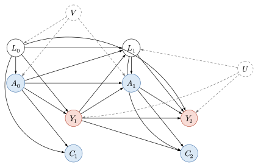

# Tutorial: Bayesian g-formula with Turing.jl

This tutorial combines Dosearch.jl with [Turing.jl](https://turinglang.org)
in a Bayesian causal inference workflow:

1. Write a model of a follow-up study in DynamicPPL, with unmeasured
   confounding, and simulate data from it.
2. Identify a causal effect nonparametrically with Dosearch.jl, with loss to
   follow-up encoded in three ways, and find how much unmeasured confounding
   the identification tolerates.
3. Fit the model to the data, predict the outcomes under each intervention
   with the posterior, and compute the effect from the predictions.

```@example tutorial
using Dosearch, Turing, Enzyme, Random, Statistics
using Logging # hide
Logging.disable_logging(Logging.Warn) # hide
nothing # hide
```

## A follow-up study

Patients visit a clinic at times ``k = 0, 1, \ldots, K - 1``. At visit ``k``,
we measure their severity ``L_k`` and decide on their treatment ``A_k``.
Before the next visit, a patient may be lost to follow-up (``C_{k+1} = 1``),
and otherwise we learn whether they died (``Y_{k+1} = 1``). Nothing is
observed after loss to follow-up or death, and death is absorbing.

Severity confounds treatment at every visit, and severity is itself affected
by earlier treatment. Two causes are not measured: the patient's access to
care ``V`` affects their severity at baseline and every treatment decision,
and their frailty ``U`` affects their later severity and death. Loss to
follow-up depends only on the measured past.

Every variable has a logistic model in its past, with coefficients shared
over time, and the unmeasured causes are standard normal. The loadings
``\lambda \geq 0`` fix the direction of ``U`` and ``V``. The same model
generates the data and is fitted to them. It creates its variables itself,
and data enter it only by conditioning. The argument `intervention` is a rule
that sets treatment from the history of severity, and it prevents loss to
follow-up. Without it, treatment and loss to follow-up follow their models.

```@example tutorial
@model function followup(N, K; intervention = nothing)
    # column k + 1 of L and A is visit k, column k of C and Y the interval
    # that ends at visit k
    L, A, C, Y = (Matrix{Bool}(undef, N, K) for _ in 1:4)
    α ~ Normal(0, 1.5)                                  # severity L₀
    θL ~ filldist(Normal(0, 1.5), 3)                    # severity Lₖ: 1, Lₖ₋₁, Aₖ₋₁
    θA ~ filldist(Normal(0, 1.5), 3)                    # treatment Aₖ: 1, Lₖ, Aₖ₋₁
    θC ~ filldist(Normal(0, 1.5), 3)                    # loss Cₖ₊₁: 1, Lₖ, Aₖ
    θY ~ filldist(Normal(0, 1.5), 4)                    # death Yₖ₊₁: 1, L₀, Lₖ, Aₖ
    λ ~ filldist(truncated(Normal(0, 1); lower = 0), 4) # V → L₀, V → A, U → L, U → Y
    U ~ filldist(Normal(), N)                           # frailty
    V ~ filldist(Normal(), N)                           # access to care
    for i in 1:N
        for k in 1:K                                    # visit k - 1 and the interval after it
            if k == 1
                L[i, k] ~ BernoulliLogit(α + λ[1] * V[i])
            else
                L[i, k] ~ BernoulliLogit(θL[1] + θL[2] * L[i, k - 1] + θL[3] * A[i, k - 1] + λ[3] * U[i])
            end
            if intervention === nothing
                previous = k == 1 ? false : A[i, k - 1]
                A[i, k] ~ BernoulliLogit(θA[1] + θA[2] * L[i, k] + θA[3] * previous + λ[2] * V[i])
                C[i, k] ~ BernoulliLogit(θC[1] + θC[2] * L[i, k] + θC[3] * A[i, k])
            else
                A[i, k] = intervention(L[i, 1:k])
                C[i, k] = false
            end
            C[i, k] && break                            # lost: nothing more is observed
            Y[i, k] ~ BernoulliLogit(θY[1] + θY[2] * L[i, 1] + θY[3] * L[i, k] + θY[4] * A[i, k] + λ[4] * U[i])
            Y[i, k] && break                            # dead
        end
    end
end
nothing # hide
```

To simulate a study, we set the parameters to their true values with `fix`
and draw from the model. We keep what is observed: `L`, `A`, `C` and `Y`,
with `missing` for what was not measured.

```@example tutorial
true_parameters = (α = -0.4, θL = [-1.0, 1.5, -1.0], θA = [-0.5, 1.0, 1.0],
                   θC = [-2.5, 0.5, 0.3], θY = [-2.0, 0.8, 1.0, -1.0], λ = [0.8, 1.0, 1.0, 1.0])

value(draw, vn) = haskey(draw, vn) ? draw[vn] : missing
observations(draw, N, K) = (L = [value(draw, @varname(L[i, k])) for i in 1:N, k in 1:K],
                            A = [value(draw, @varname(A[i, k])) for i in 1:N, k in 1:K],
                            C = [value(draw, @varname(C[i, k])) for i in 1:N, k in 1:K],
                            Y = [value(draw, @varname(Y[i, k])) for i in 1:N, k in 1:K])

N, K = 1000, 2
data = observations(rand(Xoshiro(1), fix(followup(N, K), true_parameters)), N, K)
(lost = count(isequal(true), data.C), died = count(isequal(true), data.Y))
```

## Identification

We want the risk of death by the end of follow-up if every patient were
treated at every visit, compared with nobody being treated, and nobody were
lost to follow-up: ``P(Y_2 = 1 \mid \mathrm{do}(A_0 = a, A_1 = a, C_1 = 0,
C_2 = 0))`` for ``a = 1`` and ``a = 0``. As in Robins' approach to
censoring, loss to follow-up is intervened on like a treatment.

Without knowing the true model, we can still defend its causal graph: which
variables may affect which. Here it has an edge for every variable in the
model of another one, and the unmeasured causes ``U`` and ``V``. Since only
survivors are measured, death also points to everything measured after it.
Loss to follow-up ``C_k`` depends only on the measured past, and it points to
nothing: it hides the later variables but does not change them.



We give Dosearch.jl the measured part of the graph, and add the unmeasured
causes as candidates, `LatentCause`s of the variables they affect. The data
are what we know: the baseline and the first loss to follow-up for every
patient, and then each interval among the patients followed in it.

```@example tutorial
causal_graph = """
    L₀ -> A₀
    L₀ -> Y₁
    A₀ -> Y₁
    L₀ -> L₁
    A₀ -> L₁
    Y₁ -> L₁
    A₀ -> A₁
    L₁ -> A₁
    Y₁ -> A₁
    L₀ -> Y₂
    L₁ -> Y₂
    A₁ -> Y₂
    Y₁ -> Y₂
"""
censoring = """
    L₀ -> C₁
    A₀ -> C₁
    Y₁ -> C₂
    L₁ -> C₂
    A₁ -> C₂
"""
inputs = """
    p(L₀, A₀, C₁)
    p(Y₁, L₁, A₁, C₂ | L₀, A₀, C₁)
    p(Y₂ | L₀, A₀, C₁, Y₁, L₁, A₁, C₂)
"""
problem = DosearchProblem(inputs, "p(Y₂ | do(A₀, A₁, C₁, C₂))", causal_graph * censoring)
unmeasured = [LatentCause("L₀", "A₀", "A₁"), LatentCause("L₁", "Y₁", "Y₂")]
r = dosearch(with_candidates(problem, unmeasured))
```

The effect is identifiable despite ``U`` and ``V``, by the g-formula

```math
\begin{aligned}
&P(y_2 \mid \mathrm{do}(a_0, a_1, C_1 = 0, C_2 = 0)) \\
&\quad = \sum_{l_0, y_1, l_1} P(l_0)\, P(y_1, l_1 \mid l_0, a_0, C_1 = 0)\,
P(y_2 \mid l_0, a_0, C_1 = 0, y_1, l_1, a_1, C_2 = 0).
\end{aligned}
```

The [appendix](@ref "Appendix: derivation") derives it step by step.

The inputs claim more than we know. Conditioning on ``C_1`` means that
Dosearch.jl takes ``P(Y_1, L_1, A_1, C_2 \mid L_0, A_0, C_1)`` as known for
both values of ``C_1``, but we know it only for the patients still followed,
with ``C_1 = 0``. An input of a DAG cannot fix a variable to a value, so this
is the closest we can write. The formula is still valid, because it uses the
inputs only where we know them: it conditions on ``C_1`` and ``C_2`` at their
intervened values, 0, and never sums over them. A formula that summed over
``C_1`` would use the outcomes of patients after they were lost, so formulas
from this encoding need that check. The other encodings below state exactly
what we know, and give the same formula.

Each factor is estimated from the patients followed at that time: ``P(l_0)``
from all patients, the second factor from those followed in the first
interval, and the last from those followed in both. A complete-case analysis,
which estimates every factor from the patients followed to the end, would be
biased, since loss to follow-up depends on severity and treatment.

Nothing is measured after death. For a patient who died in the first
interval, we set ``L_1``, ``A_1`` and ``C_2`` to 0, and ``Y_2 = 1``: ``Y_k``
is death by visit ``k``. Then no patient who died has ``A_1 = 1``, and the
last factor is not estimable for them: positivity fails. It is 1, since
death is absorbing, but Dosearch.jl does not know this: it is a fact about
the outcome, not about the graph. With the hazards of death
``h_1 = P(Y_1 = 1 \mid l_0, a_0, C_1 = 0)`` and
``h_2 = P(Y_2 = 1 \mid l_0, a_0, C_1 = 0, Y_1 = 0, l_1, a_1, C_2 = 0)``,
which are estimable, the risk is

```math
\begin{aligned}
&P(Y_2 = 1 \mid \mathrm{do}(a_0, a_1, C_1 = 0, C_2 = 0)) \\
&\quad = \sum_{l_0} P(l_0)
\Big(h_1 + (1 - h_1) \sum_{l_1} P(l_1 \mid l_0, a_0, C_1 = 0, Y_1 = 0)\, h_2\Big).
\end{aligned}
```

### Sequential exchangeability

Two steps of the derivation use rule 2, one per visit:
``(Y_1, L_1, Y_2 \perp\!\!\!\perp A_0, C_1 \mid L_0, A_1, C_2)`` in the graph
without the edges out of ``A_0`` and ``C_1`` and into ``A_1`` and ``C_2``,
and ``(Y_2 \perp\!\!\!\perp A_1, C_2 \mid L_0, A_0, C_1, Y_1, L_1)`` in the
graph without the edges out of ``A_1`` and ``C_2``. These are sequential
exchangeability for treatment and censoring, in graphical form: at each visit,
treatment and staying in follow-up are independent of the future given the
measured past, with the later treatment and censoring set by the
intervention.

So one search for the joint intervention checks every visit. A search per
visit would ask about one treatment at a time, with the others left as they
are, and that is a different question. Here access to care ``V`` affects
both treatments, so the effect of ``A_0`` alone is not identifiable, although
the joint effect is:

```@example tutorial
first_alone = DosearchProblem(inputs, "p(Y₂ | do(A₀, C₁, C₂))", causal_graph * censoring)
dosearch(with_candidates(first_alone, unmeasured))
```

### Other encodings

Pearl's school describes the same data with selection nodes or with
missingness indicators instead of interventions on loss to follow-up.
Dosearch.jl supports both, and they give the same formula. So does an LDAG,
which can fix variables to values in the inputs.

A selection node ``S_k = 1 - C_k`` is 1 for the patients followed in interval
``k``. A distribution that conditions on a selection node is known only among
the selected, which is what we know. The query no longer intervenes on loss to
follow-up:

```@example tutorial
selection_inputs = """
    p(L₀, A₀)
    p(Y₁, L₁, A₁ | L₀, A₀, S₁)
    p(Y₂ | L₀, A₀, S₁, Y₁, L₁, A₁, S₂)
"""
selection_graph = causal_graph * """
    L₀ -> S₁
    A₀ -> S₁
    Y₁ -> S₂
    L₁ -> S₂
    A₁ -> S₂
"""
selection = DosearchProblem(selection_inputs, "p(Y₂ | do(A₀, A₁))", selection_graph;
                            selection_bias = "S₁, S₂")
dosearch(with_candidates(selection, unmeasured))
```

With missingness indicators, each variable that may be missing has a response
indicator, 1 if the variable is observed, and a proxy, which is the variable
where it is observed and missing otherwise: ``R_{Y_1}`` and ``Y_1^*`` for
``Y_1``, and so on. The data are the distribution of the proxies and the
indicators, which is what we observe. The indicators of ``Y_1``, ``L_1`` and
``A_1`` are equal, which a graph cannot express, so the graph lets the last
two depend on the first. This search takes about a minute.

```@example tutorial
missingness_graph = causal_graph * """
    L₀ -> R_Y₁
    A₀ -> R_Y₁
    R_Y₁ -> R_L₁
    R_Y₁ -> R_A₁
    R_Y₁ -> R_Y₂
    Y₁ -> R_Y₂
    L₁ -> R_Y₂
    A₁ -> R_Y₂
"""
missingness = DosearchProblem("p(L₀, A₀, Y₁*, L₁*, A₁*, Y₂*, R_Y₁, R_L₁, R_A₁, R_Y₂)",
                              "p(Y₂ | do(A₀, A₁))", missingness_graph;
                              missing_data = "R_Y₁ : Y₁, R_L₁ : L₁, R_A₁ : A₁, R_Y₂ : Y₂")
r_missingness = dosearch(with_candidates(missingness, unmeasured))
```

Both are the g-formula above, with selection or observation (``S = 1`` or
``R = 1``) in place of the intervention ``C = 0``. Writing ``R = 1`` for all
four response indicators being 1:

```math
\begin{aligned}
&P(y_2 \mid \mathrm{do}(a_0, a_1)) \\
&\quad = \sum_{l_0, y_1, l_1} P(l_0)\, P(y_1, l_1 \mid l_0, a_0, S_1 = 1)\,
P(y_2 \mid l_0, a_0, y_1, l_1, a_1, S_1 = S_2 = 1) \\
&\quad = \sum_{l_0, y_1, l_1} P(l_0)\, P(y_1^*, l_1^* \mid l_0, a_0, R_{Y_1} = R_{L_1} = 1)\,
P(y_2 \mid l_0, a_0, y_1, l_1, a_1, R = 1).
\end{aligned}
```

The notation of the R package, which the formula follows, leaves
``R_{Y_1} = R_{L_1} = 1`` implicit in the second factor; the derivation
writes it out. The derivations also show how the encodings meet. Before
either uses the data, a step by rule 3 intervenes on the selection nodes or
on the response indicators, which is valid because these affect none of the
other variables. So the Pearl-style derivations intervene on loss to
follow-up too. The [appendix](@ref "Appendix: derivation") shows the
derivation with missingness indicators.

Finally, a [labeled DAG](ldag.md) can say literally that the inputs are
known for ``C_1 = 0`` and ``C_2 = 0``, since its distributions can fix
variables to values. Interventions are explicit nodes such as ``I_{A_0}``:
the edges into an intervened variable vanish when its intervention node is 1.
The unmeasured causes are explicit latent nodes, and the query sets
``C_1 = C_2 = 0`` with their intervention nodes.

```@example tutorial
ldag_graph = """
    I_A₀ -> A₀
    I_A₁ -> A₁
    I_C₁ -> C₁
    I_C₂ -> C₂
    V -> L₀
    V -> A₀ : I_A₀ = 1
    L₀ -> A₀ : I_A₀ = 1
    L₀ -> C₁ : I_C₁ = 1
    A₀ -> C₁ : I_C₁ = 1
    U -> Y₁
    L₀ -> Y₁
    A₀ -> Y₁
    U -> L₁
    L₀ -> L₁
    A₀ -> L₁
    Y₁ -> L₁
    V -> A₁ : I_A₁ = 1
    A₀ -> A₁ : I_A₁ = 1
    L₁ -> A₁ : I_A₁ = 1
    Y₁ -> A₁ : I_A₁ = 1
    Y₁ -> C₂ : I_C₂ = 1
    L₁ -> C₂ : I_C₂ = 1
    A₁ -> C₂ : I_C₂ = 1
    U -> Y₂
    L₀ -> Y₂
    L₁ -> Y₂
    A₁ -> Y₂
    Y₁ -> Y₂
"""
ldag_inputs = """
    p(L₀, A₀, C₁)
    p(Y₁, L₁, A₁, C₂ | L₀, A₀, C₁ = 0)
    p(Y₂ | L₀, A₀, C₁ = 0, Y₁, L₁, A₁, C₂ = 0)
"""
ldag_query = "p(Y₂ | A₀, A₁, C₁ = 0, C₂ = 0, I_A₀ = 1, I_A₁ = 1, I_C₁ = 1, I_C₂ = 1)"
dosearch(DosearchProblem(ldag_inputs, ldag_query, ldag_graph))
```

This is the g-formula exactly as written above.

### Unmeasured confounding

How much unmeasured confounding could there be? The maximal identifiable
graphs answer this: every maximal set of pairs of variables that can have an
unmeasured common cause while the effect stays identifiable. We search with
selection nodes, where Dosearch.jl uses the data only among the patients
followed, so every set it finds is identifiable from what we know. We assume
that loss to follow-up shares no unmeasured cause with the other variables,
so the candidates are the pairs of the other variables.

```@example tutorial
selected = ("S₁", "S₂")
candidates = [c for c in confounding_candidates(selection) if c.x ∉ selected && c.y ∉ selected]
maximal = maximal_identifiable_graphs(selection; candidates)
length(maximal)
```

Our confounding is one of these maximal sets: an unmeasured common cause of
any further pair of variables would make the effect non-identifiable.

```@example tutorial
ours = Set(BidirectedPair(x, y) for c in unmeasured for x in c.variables for y in c.variables if x < y)
ours in Set.(maximal)
```

## Estimation

We condition the model on the data with `|` and sample from the posterior
with NUTS, using Enzyme for the gradients. Conditioning on a matrix with
`missing` values conditions on the observed values only. The likelihood then
has a factor for each variable of each patient while followed, so each part
of the model is fitted to the patients followed at that time, as in the
identifying formula.

```@example tutorial
model = followup(N, K) | data
chain = sample(Xoshiro(2), model, NUTS(; adtype = AutoEnzyme()), 500; progress = false)
nothing # hide
```

An intervention is a rule from the history of severity to treatment. Besides
the static rules, always and never treat, it can be dynamic, such as treating
whenever the current severity is high. The same g-formula identifies such a
rule, with ``a_k`` set by the rule.

```@example tutorial
always(history) = true
never(history) = false
when_severe(history) = last(history)
nothing # hide
```

For each intervention, `predict` simulates the follow-up of the patients from
their observed baseline severity and their posterior frailty, for every
posterior draw. This computes the identifying formula by simulation (the
parametric g-formula), since the fitted model contains every factor of it.
Then we compute the risk of death by the end of follow-up in each draw.

```@example tutorial
function predict_followup(chain, data, intervention)
    N, K = size(data.Y)
    baseline = (L = [k == 1 ? data.L[i, 1] : missing for i in 1:N, k in 1:K],)
    return predict(Xoshiro(3), followup(N, K; intervention) | baseline, chain)
end

function risk(predictions, N, K)
    deaths = zeros(size(predictions, 1))
    for i in 1:N
        died = falses(length(deaths))
        for k in 1:K
            died .|= isequal.(vec(predictions[@varname(Y[i, k])]), true)
        end
        deaths .+= died
    end
    return deaths ./ N
end

risks = Dict(rule => risk(predict_followup(chain, data, rule), N, K)
             for rule in (always, never, when_severe))
nothing # hide
```

The posterior of the effects, as risk differences with never treating:

```@example tutorial
summarize(draws) = (mean = round(mean(draws), digits = 3),
                    interval_95 = round.(quantile(draws, [0.025, 0.975]), digits = 3))
(always = summarize(risks[always] .- risks[never]),
 when_severe = summarize(risks[when_severe] .- risks[never]))
```

To check them, we simulate a large population from the true model under each
intervention:

```@example tutorial
function true_risk(intervention; N = 100_000, K = 2)
    draw = rand(Xoshiro(0), fix(followup(N, K; intervention), true_parameters))
    return mean(any(k -> isequal(value(draw, @varname(Y[i, k])), true), 1:K) for i in 1:N)
end
(always = round(true_risk(always) - true_risk(never), digits = 3),
 when_severe = round(true_risk(when_severe) - true_risk(never), digits = 3))
```

Treating at every visit reduces the risk of death substantially, treating
only when severe less, and the 95% posterior intervals cover the true
effects.

The workflow carries over to other studies and longer follow-ups. Dosearch.jl
tells from the causal graph alone whether an effect is a function of the
observed data, and how much unmeasured confounding that survives. A model of
the data then gives the posterior of the effect.

## Appendix: derivation

The derivation of the identifying formula from the query, by
[`latex`](@ref):

```@example tutorial
function math_display(r) # hide
    tex = replace(latex(r), "\\begin{align*}\n" => "\\begin{aligned}\n&", " &= " => " \\\\\n&= ", # hide
                  "\\end{align*}" => "\\end{aligned}", " && " => " \\\\\n&\\qquad ") # hide
    return HTML("<p class=\"math-container\">\\[" * replace(tex, "&" => "&amp;") * "\\]</p>") # hide
end # hide
math_display(r) # hide
```

With missingness indicators instead, the first steps intervene on the
response indicators:

```@example tutorial
math_display(r_missingness) # hide
```
